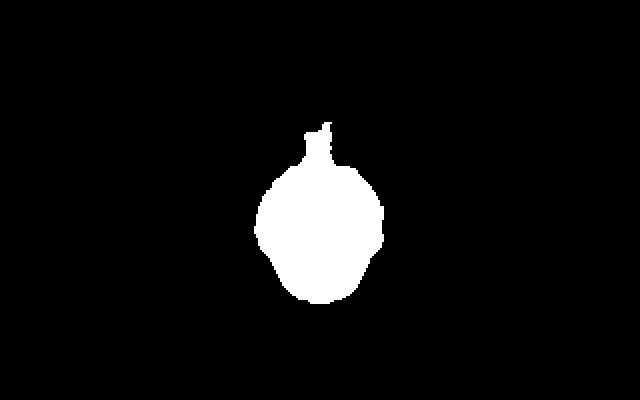

# Bad Apple!! pro Tesla SAPI-1

Demo **Bad Apple!!** pro **Tesla SAPI-1** v sestavě „V“ Libora Lasoty. Stínové video Anira (Touhou Project)
běží celé v rozlišení **256 × 192 při 29,97 snímku/s** na barevné grafice **CGA-1V**. K němu hraje
**vlastní FM aranžmá** písně Bad Apple!! (Alstroemeria Records feat. nomico) na čipu YM3812 zvukové karty
**MPH-1V**, synchronizované s obrazem. Demo běží pod CP/M jako `BADAPPLE.COM` a 3 MB dat čte za běhu
z RAM disku **ZRD-1V** nebo **ZRMD-1**.

| | | |
|---|---|---|
|  |  |  |
|  |  |  |

*Snímky z emulátoru SAPIemu (CGA-1V, 320 × 200, obraz dema uprostřed).*

## Stav: verze 1.0.0 (2026-10-09)

- **Celé video** (3 min 40 s, 6393 snímků) s hudbou od začátku do konce, pak návrat do CP/M. Klávesa demo
  ukončí dřív.
- **Ověřeno na skutečném SAPI-1** (sestava V, 2026-10-09) a v emulátoru
  [SAPIemu](https://github.com/mlukasek/SAPIemu) 0.3.0-alpha. Podrobnosti a co zbývá ověřit jsou
  v [docs/hw-otazky.md](docs/hw-otazky.md), změny v [CHANGELOG.md](CHANGELOG.md).
- Pro srovnání nejlepší známé verze na počítačích s 8080/Z80: Vector-06c 64 × 48 při 12,5 snímku/s a PMD 85
  180 × 70 při 9,1 snímku/s.
- **Hotový obraz RAM disku** s demem je ve
  [vydání 1.0.0](https://github.com/mlukasek/SAPI-Bad-Apple/releases/tag/v1.0.0)
  (`SAPI-Bad-Apple-1.0.0-ramdisk.zip`: `ramdisk.bin` a `ramdisk.hex`).
- Repozitář neobsahuje video ani hudbu, jen zdrojáky a nástroje. Ze své kopie videa jde demo vyrobit podle
  návodu níže.

## Jak to funguje

**Obraz:**
- 256 × 192 bodů, 1 bit na bod, v režimu CGA karty CGA-1V (2 bity na bod) uprostřed obrazovky.
- Kreslí se do skryté ze dvou stránek, ve VBI (59,94 Hz) se přepne.
- Ve skryté stránce je snímek o dva starší. Snímek se proto kóduje jako rozdíl proti němu: svislé „stopy“
  intervalů XOR, jeden kód na řádek stopy.
- Každý kód má v Z80 vlastní vygenerovanou obsluhu bez tabulek. Řádek stopy v jednom bajtu stojí 81 T.
- **Kodér v Pythonu počítá takty dekodéru i přerušení** (cyklový model s čekáním CGA-1V naměřeným na HW).
  - 95,5 % snímků se stihne za 2 VBI.
  - Těžký snímek (střih, rychlý pohyb) se ukáže o VBI později a další snímek se vezme podle skutečného času,
    takže video se nezpožďuje.
- **Úpravy obrazu v kodéru:**
  - mrtvá zóna: chvějící se hrana se nepřekresluje;
  - oprava zubů na svislých hranách;
  - hvězdy a rozmazané hvězdy v nočním letu, které by práh 50 % smazal.
- Video má 3,1 MB, čte se z RAM disku přes porty ZRD-1V do kruhového bufferu 32 KB.

**Zvuk:**
- Vlastní aranžmá pro YM3812: 6 melodických hlasů (zpěv, basa, kytary, plocha, arpeggio) a bicí
  v rytmickém režimu.
- Melodie, akordy a stavba skladby jsou přepsané ze zvuku videa měřením (FFT, stereo střed a strany).
  Nástroje a bicí jsou laděné poslechem a porovnáním pásem s originálem.
- Přerušení 1300 Hz z časovače 82C54 zapíše vždy nejvýš jeden registr YM3812. Hudba se řídí hodinami videa:
  když se obraz zdrží, hudba plynule zpomalí, takže spolu pořád drží.

Podrobně v [docs/format.md](docs/format.md) a [docs/rozhodnuti.md](docs/rozhodnuti.md).

## Co je potřeba

- SAPI-1 se sestavou V:
  - **JPR-1V** (Z80, TURBO **4 MHz**);
  - **RAM-1V** (64 KB, registr MAP na 63h);
  - **CGA-1V** na C000h při MAP1 = MAP2 = H, obraz na jejím monitoru VGA;
  - **MPH-1V** na 50h (YM3812, 82C54);
  - RAM disk **ZRD-1V** nebo **ZRMD-1** (4 MB) s CP/M, ze kterého bootuje ECMON;
  - konzole pro ECMON a CP/M, jinak demo nejde spustit: **AND-1V** (textová grafika s klávesnicí na JPR-1V)
    nebo **DSM-1V** (sériový terminál).
- Demo potřebuje **celý RAM disk** A: (asi 3,2 MB dat).
  - Nahrává se jako celý obraz disku (`ramdisk.bin`, 4 MB).
  - V SAPIemu se jen připojí. Na skutečném SAPI-1 je potřeba ho **nahrát do RAM disku ZRD-1V nebo
    ZRMD-1**, přes DSM-1V nebo jiným zařízením (`ramdisk.hex` v Intel HEX).

## Jak demo vyrobit

Repozitář **neobsahuje video ani hudbu** (jsou chráněné autorským právem), proto se `BADAPPLE.DAT` vyrábí
z vlastní kopie videa:

1. **Potřeba je:**
   - Python 3, jen standardní knihovna;
   - [ffmpeg](https://ffmpeg.org/) na `PATH`;
   - assembler [pasmo](https://pasmo.speccy.org/) 0.5.3;
   - obraz CP/M RAM disku pro SAPI (ze SAPIemu).

   Cesty a podrobný postup jsou v [docs/vyvoj.md](docs/vyvoj.md).
2. **Video** dát do `orig\Touhou - Bad Apple_003.avi`.
   - Je to bezztrátové video 480 × 360 při 30 snímcích/s, 6571 snímků.
   - Na počtu snímků a začátku záleží, podle nich je hudba sladěná s obrazem.
3. **`build.cmd video`:** vznikne `build\ramdisk.bin` (a totéž v Intel HEX `build\ramdisk.hex`). Je to celý
   RAM disk s CP/M, `BADAPPLE.COM` a `BADAPPLE.DAT`.

## Spuštění

Obraz RAM disku je buď z vydání (`ramdisk.bin`, `ramdisk.hex`), nebo z `build.cmd video`
(`build\ramdisk.bin`, `build\ramdisk.hex`).

- **SAPIemu:** `sapiemu.exe --machine tools\emu\badapple_sapi1v.sapi` (sestava V s RAM diskem
  `build\ramdisk.bin`; obraz z vydání tam stačí nakopírovat). Po startu v nabídce ECMON `1`, pak v CP/M
  `BADAPPLE`.
- **Skutečné SAPI-1:**
  - nahrát celý obraz do RAM disku **ZRD-1V nebo ZRMD-1** (`ramdisk.bin`, nebo `ramdisk.hex` v Intel HEX
    s rozšířenou adresou před každými 64 KB);
  - v nabídce ECMON zvolit `1`, pak `BADAPPLE`.
- Libovolná klávesa demo ukončí a vrátí se do CP/M.

## Dokumentace

| Soubor | Co |
|---|---|
| [docs/format.md](docs/format.md) | formát dat: `BADAPPLE.DAT`, proud videa a dekodér, proud hudby a přehrávač, synchronizace, aranžmá |
| [docs/vyvoj.md](docs/vyvoj.md) | vývoj: jak začít na jiném počítači, překlad, nástroje, testy, pasti |
| [docs/rozhodnuti.md](docs/rozhodnuti.md) | rozhodnutí s důvody a měřeními (formát videa, úpravy obrazu, přepis a zvuk hudby) |
| [docs/hw-otazky.md](docs/hw-otazky.md) | ověření na skutečném hardwaru |
| [docs/sapiemu-podnety.md](docs/sapiemu-podnety.md) | zjištění pro vývoj emulátoru SAPIemu |
| [CHANGELOG.md](CHANGELOG.md) | změny po verzích |

## Autoři a poděkování

- **Bad Apple!!:** hudba ZUN (Touhou Gensokyo ~ Lotus Land Story, Touhou Project). Aranžmá Alstroemeria
  Records (Masayoshi Minoshima), zpěv nomico. Stínové video (PV) Anira.
- **Port na SAPI-1:** Martin Lukášek, 2026, s pomocí Claude (Anthropic). Aranžmá pro YM3812 je vlastní,
  přepsané ze zvuku videa.
- **Karty sestavy V** (JPR-1V, RAM-1V, AND-1V, DSM-1V, CGA-1V, MPH-1V, ZRD-1V): Libor Lasota.
- [pasmo](https://pasmo.speccy.org/) (Julián Albo) překládá program, [ffmpeg](https://ffmpeg.org/) čte
  video a zvuk.

## Autorská práva

Kód dema a nástroje jsou pod licencí GNU GPL v3 ([LICENSE](LICENSE)). Píseň, aranžmá Alstroemeria Records
a video patří svým autorům. Repo je proto neobsahuje. Obraz RAM disku ve vydání obsahuje video a hudbu
převedené pro SAPI-1.
Několik snímků obrazovky v `docs/img` slouží jen jako ilustrace. Demo je nekomerční projekt pro zachování
a oživení historického československého počítače SAPI-1.
